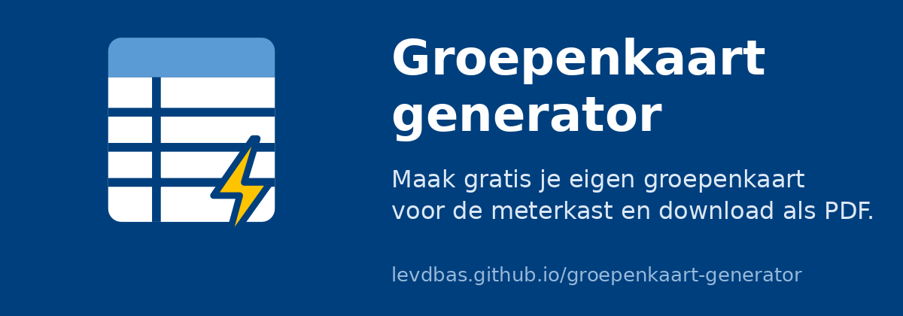

[](https://levdbas.github.io/groepenkaart-generator/)

# Groepenkaart generator

Een kleine webapp om een groepenkaart (groepenindeling) voor je meterkast of verdeelkast te maken en als PDF te downloaden of af te drukken. De app draait volledig in de browser.

**[➜ Open de Groepenkaart generator](https://levdbas.github.io/groepenkaart-generator/)**

## Functies

- Meerdere **kasten** toevoegen, elk met een nummer, een naam en een maat: het aantal DIN-rails en het aantal modules per rail (bijvoorbeeld 2 × 12)
- Een **visuele kast**: een grijze kast met de rails en een plek per module. Een lege plek toont een **+**; klik erop om in een venster een module toe te voegen met type, nummer, omschrijving, kenmerk en optionele aansluitingen. De breedte volgt uit het gekozen moduletype; bij een type met variabele breedte (nu `RCBO-2P`: 1 of 2 DIN-modules; `OTHER`: 1 tot 4) kies je de breedte zelf. Typen en breedtes die op die plek niet passen, zijn niet te kiezen.
- Een module **selecteren** (klik) en daarna naar links of rechts verplaatsen, bewerken, dupliceren of verwijderen. Dupliceren zet een kopie (zelfde type, breedte, koppeling en instellingen, met een nieuw nummer) op de eerstvolgende vrije plek; klik nogmaals op **Dupliceren** om een hele rij te vullen. Rechts voorbij het einde van een rail gaat de module naar het begin van de volgende rail; links voorbij het begin naar het einde van de vorige rail. Op een bezette plek wisselt de module van plek met de buurmodule. Met het toetsenbord werken ← en → ook, Delete verwijdert en Esc heft de selectie op.
- **Bijzondere installaties**: kies bij een installatieautomaat of krachtgroep een zonnepanelen-, EV-lader- of thuisbatterij-installatie. Elke gekozen installatie geeft een compacte rode kaart met pictogram op de eerste pagina, in de PDF. Alle drie passen naast elkaar.
- **Aardlekbeveiliging**: plaats RCD- of RCBO-modules in de kast, net als andere modules, en geef ze een kleur. Andere modules kunnen aan een RCD-module worden gekoppeld; de kleurstreep op de module, de nummerkleur en de legenda volgen die beveiliging. Modules zonder plek, zoals aardlekschakelaars uit oudere bestanden, staan onder **Niet geplaatst** en kunnen via een lege plek (+) alsnog in een kast worden geplaatst.
- **Expertmodus** (standaard uit): toont de technische velden gevoeligheid, aardlektype en nominale stroom bij aardlekschakelaars en aardlekautomaten, en nominale stroom bij andere modules. Staat de expertmodus uit, dan blijven ingevulde waarden bewaard en in de PDF staan. Deze instelling wordt per browser bewaard en zit niet in de kaartgegevens.
- **Fasen**: zet **Fasen documenteren (3-faseninstallatie)** aan. Kies bij elke RCD-module het 2- of 4-polige type. Een 2-polige beveiliging heeft één te kiezen fase (L1, L2 of L3); gekoppelde modules nemen die fase over. Een 4-polige beveiliging heeft alle drie de fasen; modules hierop kiezen zelf één of meer fasen, net als modules zonder koppeling. De fasen verschijnen in de PDF.
- **Voeding per kast**: leg een hoofdaansluiting, onderverdeler of gekoppelde kast vast. Een onderverdeler verwijst met een stabiele module-ID naar de bronbeveiliging; voorbeveiliging en kabelgegevens verschijnen in de PDF. Een gekoppelde kast deelt de hoofdaansluiting van een andere kast, die je bij **Gekoppeld aan** kiest.
- **QR-code**: zet **QR-code toevoegen aan de PDF** aan (de bovenste optie) en de laatste pagina van de PDF krijgt een QR-code. Scannen opent de app met alle gegevens, zodat je de groepenkaart op een andere telefoon of computer kunt aanpassen. Zie [QR-code en deellink](#qr-code-en-deellink).
  Elke vrije plek op een rail krijgt een lege regel, op de plek in de fysieke volgorde waar de module zou zitten; een brede module blijft één regel. Zo is de tabel makkelijk te vergelijken met de kast en blijft er ruimte om met de hand een module toe te voegen.
- Automatisch **opslaan in de browser** (localStorage)
- **Exporteren en importeren** als JSON-bestand, voor een back-up of om op een andere computer verder te werken

De optie **Fasen** staat boven **Aardlekschakelaars**. Met faseregistratie aan toont het modulevenster de fasekeuze; met koppelen aan aardlekschakelaars aan de keuze van de aardlekschakelaar.

Op een smal scherm schuift de visuele kast horizontaal, zodat elke plek groot genoeg blijft om aan te tikken.

Niet gekozen fasen en lege regels krijgen geen gekleurde rand.

## Gebruik

1. Open de [web app](https://levdbas.github.io/groepenkaart-generator/) of [draai de app lokaal](#lokaal-draaien).
2. Klik onderaan de pagina op **+ Kast toevoegen**. Kies een veelgebruikte maat (1 × 12 tot 4 × 12) of vul zelf het aantal rails (1 tot 99) en modules per rail (4 tot 48) in. Vul daarna boven de kast een kastnummer en een naam in, bijvoorbeeld `1` en `Meterkast begane grond`. De maat kun je later nog wijzigen; kleiner maken kan alleen als alle modules blijven passen.
3. Klik op een lege plek (**+**) om daar een module toe te voegen. Het modulenummer wordt automatisch opgehoogd en kan worden aangepast, bijvoorbeeld naar `1a` of `F3`. Een module begint op de gekozen plek en neemt naar rechts zoveel plekken in als het type breed is. Klik op een module om hem te selecteren; onder de kast verschijnen dan knoppen om hem te verplaatsen (◀ ▶), te bewerken of te verwijderen. Klik nog een keer op een geselecteerde module om hem te bewerken.
4. Kies in het venster het type. De DIN-breedte en beschikbare fasen volgen uit het type; heeft het type een variabele breedte, dan verschijnt een keuzelijst **Breedte** met de toegestane breedtes (de breedtes die niet passen zijn uitgeschakeld). Kies je een type met één fase, dan worden de gekozen fasen gewist; een type met drie fasen heeft altijd L1, L2 en L3, die vooraf zijn aangevinkt en niet te wijzigen zijn. Vul de omschrijving en eventueel een vrij kenmerk in. Bij **Aansluitingen** kun je per regel een apparaat of aansluiting invullen. Lege regels worden genegeerd; aansluitingen verschijnen als opsomming onder de omschrijving in de PDF. Wijzigingen worden opgeslagen met **Toevoegen** of **Opslaan**; **Annuleren** laat de module ongewijzigd.
5. Hangt er een PV-installatie, EV-lader of thuisbatterij achter een module? Vink dan bij **Bijzondere installaties** van die installatieautomaat (`MCB`) of krachtgroep (`MCB-3P`) de installatie(s) aan; meerdere installaties op één module kan ook. Dat kan per module en bij meerdere modules; dezelfde installatie geeft maar één kaart. De kaarten tonen alleen het pictogram met een rode rand.
6. Wil je modules aan aardlekschakelaars koppelen? Plaats een aardlekschakelaar (`RCD-2P` of `RCD-4P`) of aardlekautomaat in de kast; **Modules koppelen aan aardlekschakelaars** gaat dan vanzelf aan. Een nieuwe aardlekschakelaar krijgt automatisch een code (`A1`, `A2`, …) en kleur; pas code, omschrijving en kleur naar wens aan. Kies daarna bij andere modules de **Aardlekschakelaar**. Een dinrail stopcontact (`DIN-OUTLET`) koppel je niet aan een aardlekschakelaar maar via **Aangesloten op** aan een installatieautomaat (`MCB`, `MCB-2P` of `MCB-3P`) of aardlekautomaat; het neemt dan de kleur en een 2-polige fase van de aardlekschakelaar van die automaat over, plus de fasen en de nominale stroom van de automaat zelf (de eigen waarden blijven bewaard en komen terug zodra je de koppeling verwijdert), en de PDF toont de automaat. Een overige module (`OTHER`) kun je via **Aangesloten op** ook rechtstreeks aan een aardlekschakelaar koppelen; die neemt dan de kleur van die aardlekschakelaar over. Gevoeligheid en aardlektype (alleen bij aardlekschakelaars en aardlekautomaten) en nominale stroom zijn optioneel en zichtbaar met **Expertmodus** aan. Een aardlekschakelaar kan modules in elke kast beveiligen. Zet je het koppelen uit, dan worden de koppelingen en de niet-geplaatste aardlekschakelaars gewist; geplaatste aardlekschakelaars en aardlekautomaten worden installatieautomaten, zodat hun plek behouden blijft.
7. Wil je dat de PDF een QR-code met alle gegevens bevat? Vink dan bovenaan **QR-code toevoegen aan de PDF** aan.
8. Klik op **Voorbeeld** om de PDF per pagina in een venster te bekijken, met in- en uitzoomen, of op **PDF downloaden** voor een PDF-bestand. Het voorbeeld wordt in de browser getekend en werkt ook op mobiele apparaten. Print de PDF als je een papieren kaart wilt.

### QR-code en deellink

Met **QR-code toevoegen aan de PDF** komt onder de laatste tabel een QR-code van circa 5,5 cm met een korte uitleg. De QR-code bevat een link naar de app met alle gegevens van de groepenkaart in het deel na de `#`, bijvoorbeeld `https://levdbas.github.io/groepenkaart-generator/#c2=…`. Dit deel van een link gaat nooit naar een server.

Om de QR-code compact te houden, worden de gegevens herschreven naar korte lijsten zonder veldnamen en daarna met deflate gecomprimeerd ([src/js/share.js](src/js/share.js)). In `c2` verwijzen boxen en modules onderling met lijstposities in plaats van lange IDs; bij openen worden nieuwe IDs gemaakt en blijven alle relaties behouden. De tekens `0-9 A-Z - + * $` passen in de compactere alfanumerieke modus van een QR-code. Het formaat `c2` beschrijft schemaversie 5. Bestaande `c1`-links (v4) en oudere `#data=`-links kunnen nog steeds worden geopend.

Opent iemand zo'n link, dan valideert en migreert de app de gegevens net als bij **Importeren**, vraagt bevestiging als er al gegevens zijn, en haalt daarna de gegevens uit de adresbalk. Oude QR-codes blijven werken na een nieuwe schemaversie, omdat `schemaVersion` in de gegevens zit.

Een QR-code heeft een maximale capaciteit van ongeveer 2950 tekens. Dat is ruim voldoende voor een gewone groepenkaart. Past een kaart er niet in, dan toont de app een melding en maakt de PDF zonder QR-code; bewaar de gegevens dan met **Exporteren**. De QR-code is een momentopname: wijzig je de kaart daarna, dan komt de gedrukte code niet meer overeen.

### Gegevens bewaren

Alles wat je invoert wordt automatisch opgeslagen in je browser. Wis je de browsergegevens of gebruik je een andere browser of computer, dan ben je de gegevens kwijt. Gebruik daarom **Exporteren** om een `groepenkaart.json` te bewaren. Met **Importeren** laad je dat bestand later weer in.

De gegevens gebruiken schema v5. `modules` bevat alle DIN-modules, waaronder losse RCD's en RCBO's. Elke module heeft een stabiele `id`, een type volgens de catalogus in [src/js/schema.js](src/js/schema.js) (zie [module-types.md](module-types.md)), nummer, omschrijving, vrij kenmerk, fasen en een optionele `protectedByModuleId`. De typecatalogus bepaalt de breedte en fasebeschikbaarheid; die vaste waarden worden niet gekopieerd naar elk module-item. `items`, `ratedCurrent`, `rcdType`, `sensitivity`, `color` en `warnings` zijn optioneel. `warnings` is een lijst met unieke waarden `pv`, `ev` en/of `battery` en is alleen toegestaan op de typen die volgens de catalogus een waarschuwing mogen geven (`MCB`, `MCB-3P`); de waarschuwingskaarten op de eerste pagina volgen uit alle modules.

Voorbeeld van een exportbestand:

```json
{
  "$schema": "https://raw.githubusercontent.com/Levdbas/groepenkaart-generator/main/schemas/groepenkaart-v5.schema.json",
  "schemaVersion": 5,
  "qrEnabled": true,
  "rcdEnabled": true,
  "phaseEnabled": true,
  "modules": [
    {
      "id": "module-1",
      "boxId": "box-1",
      "rail": 1,
      "slot": 3,
      "type": "MCB",
      "number": "1",
      "description": "Keuken – wandcontactdozen aanrecht",
      "characteristic": "B16",
      "phases": [],
      "protectedByModuleId": "rcd-1",
      "items": ["Vaatwasser", "Wandcontactdozen aanrecht"],
      "ratedCurrent": 16
    },
    {
      "id": "rcd-1",
      "boxId": "box-1",
      "rail": 1,
      "slot": 1,
      "type": "RCD-2P",
      "number": "A1",
      "name": "Keuken en badkamer",
      "color": "#ed8c01",
      "description": "",
      "characteristic": "",
      "phases": ["L1"],
      "protectedByModuleId": null,
      "sensitivity": 30,
      "rcdType": "A",
      "ratedCurrent": 40
    }
  ],
  "boxes": [
    {
      "id": "box-1",
      "number": "1",
      "name": "Meterkast begane grond",
      "rails": 2,
      "railWidth": 12,
      "moduleIds": ["rcd-1", "module-1"],
      "supply": {
        "type": "mains",
        "connectionRating": "3x25A",
        "supplier": "Stedin",
        "mainSwitchCurrent": 40,
        "mainSwitchPoles": 4
      }
    }
  ]
}
```

### Schemaversies en migraties

JSON-exportbestanden en browseropslag bevatten `schemaVersion: 5`. Dit is de versie van het gegevensformaat, onafhankelijk van de appversie. De typecatalogus, de gedeelde gegevenstypen, validatie en migraties staan samen in [src/js/schema.js](src/js/schema.js).

Elke box bewaart een stabiele `id`, het aantal DIN-rails `rails` (1 tot 99), het aantal modules per rail `railWidth` (4 tot 48), de `moduleIds` en een `supply`-object of `null`. Modules staan één keer in `modules`; `boxId` legt hun fysieke kast vast en `rail` en `slot` (beide vanaf 1) de rail en de eerste plek die de module inneemt. Vanaf die plek neemt de module de breedte van zijn type in (of de eigen `width` bij een variabele breedte); modules moeten binnen de rail vallen en mogen elkaar niet overlappen. `moduleIds` staat in fysieke volgorde: rail voor rail, van links naar rechts. `boxId: null` betekent dat de locatie nog onbekend is; zo'n module heeft geen `rail` en `slot`. `protectedByModuleId` verwijst naar een RCD- of RCBO-module; typen met `mcbLinkable` in de catalogus (nu `DIN-OUTLET` en `OTHER`) verwijzen in plaats daarvan naar een `MCB`-, `MCB-2P`-, `MCB-3P`- of RCBO-module; alleen typen met ook `rcdLinkable` (nu `OTHER`) mogen daarnaast naar een RCD verwijzen; een hoofdschakelaar (`MAINS-2P`, `MAINS-4P`) staat vóór de aardlekschakelaar en heeft altijd `null`. Een onderverdeler verwijst met `sourceModuleId` naar de bronmodule; het omgekeerde “voedt kast” wordt afgeleid. Verwijzingen gebruiken IDs, niet de bewerkbare kast- of modulenummers.

`supply.type` is `mains`, `subdistribution` of `linked`. Een hoofdaansluiting kan een standaard `connectionRating` of `Anders` met `customConnectionRating`, netbeheerder en hoofdschakelaargegevens bevatten. Een onderverdeler kan een bronmodule, voorbeveiliging, aantal kabeladers, kabeldoorsnede en hoofdschakelaargegevens bevatten. Een gekoppelde kast (`linked`) zit direct naast een andere kast en krijgt zijn voeding via de hoofdaansluiting van die kast; `sourceBoxId` verwijst naar de ID van die andere kast, die zelf een `mains`-voeding moet hebben. Niet-ingevulde eigenschappen worden weggelaten.

RCD-modules kunnen optioneel `sensitivity` (10, 30, 100 of 300 mA), `rcdType` (AC, A, F, B of B+) en `ratedCurrent` bevatten. `ratedCurrent` is een getal in ampère. `characteristic` is een vrije notitie. Moduletype bepaalt de DIN-breedte; de breedte wordt alleen per module opgeslagen (`width`, een geheel getal) bij typen met een variabele breedte in de catalogus (`widthRange`, nu `RCBO-2P`: 1 tot 2; `OTHER`: 1 tot 4). Ontbreekt `width`, dan geldt de standaardbreedte van het type; bij andere typen is `width` niet toegestaan. Fasen blijven een lijst met unieke codes `L1`, `L2`, `L3`; een 2-polige RCD heeft maximaal één fase en een 4-polige RCD alle drie.

Het [JSON Schema voor versie 5](schemas/groepenkaart-v5.schema.json) is beschikbaar via [raw.githubusercontent.com](https://raw.githubusercontent.com/Levdbas/groepenkaart-generator/main/schemas/groepenkaart-v5.schema.json). Schema's v1-v4 blijven ongewijzigd gepubliceerd en oude JSON-bestanden worden automatisch gemigreerd. Elke voormalige groep wordt een `MCB`-module met nummer, omschrijving, aansluitingen, fasen en bescherming behouden. Oude RCD-ID's blijven behouden als RCD-module-ID's; omdat v4 geen fysieke kastlocatie voor RCD's vastlegde, worden die modules gemigreerd met `boxId: null` en staan ze in de app onder **Niet geplaatst**. Kasten krijgen rails van 12 modules; de modules worden in hun oude volgorde van links naar rechts geplaatst, en zoveel rails als nodig (minimaal één). `qrEnabled` en `phaseEnabled` blijven behouden. De globale lijst `warnings` bestaat niet meer: elke oude waarschuwing `pv`, `ev` of `battery` wordt een `MCB`-module in de eerste kast met de bijbehorende `warnings`-lijst (bijvoorbeeld "PV-installatie (zonnepanelen)") en blijft dus zichtbaar; de verouderde code `heat-pump` had geen kaart meer en vervalt. Heeft het bestand geen kasten, dan is er geen eerste pagina en vervallen de waarschuwingen.

Compacte deellinks gebruiken `c2` voor v5. Bestaande `c1`-links voor v4 en `#data=`-links blijven leesbaar. In een compact link worden stabiele IDs vervangen door lijstposities en bij openen opnieuw aangemaakt; alle module-, bescherming- en voedingsrelaties blijven intact, net als de maat van elke kast en de plek van elke module. Dezelfde browseropslagsleutel `groepenkaart:v1` blijft in gebruik; oude versies van de app weigeren v5-bestanden in plaats van gegevens stilzwijgend te verliezen.

Een onbekende nieuwere versie wordt geweigerd met een melding. Bij een mislukte import blijven de huidige gegevens intact. Als browseropslag niet kan worden geladen, blijft die bewaard en schrijven bewerkingen er niet overheen totdat je bewust een geldig bestand importeert of **Alles wissen** bevestigt.

Bij een toekomstige formaatwijziging: verhoog `currentVersion`, werk de gegevenstypen en validatie bij, voeg een migratiestap van versie N naar N+1 toe en publiceer een nieuw schema zonder het oude te wijzigen. Voeg regressietests toe voor de volledige migratieketen. Een nieuwe functie die het gegevensformaat niet verandert, hoeft geen nieuwe schemaversie te krijgen.

## Lokaal draaien / development

Je hebt [Node.js](https://nodejs.org/) 20.11 of nieuwer nodig. De app moet eerst gebouwd worden: `src/index.html` direct in de browser openen werkt niet, omdat de CSS- en JS-bestanden pas tijdens de build worden ingevuld.

1. Haal de code op en installeer de dependencies:

   ```bash
   git clone https://github.com/Levdbas/groepenkaart-generator.git
   cd groepenkaart-generator
   npm install
   ```

2. Start de ontwikkelserver:

   ```bash
   npm run dev
   ```

   Dit bouwt de app naar `dist/` en start een webserver op <http://localhost:8000>. Bij elke wijziging in `src/` of `public/` wordt de app automatisch opnieuw gebouwd. Ververs daarna de pagina om het resultaat te zien. Een andere poort kies je met `PORT=3000 npm run dev`.

3. Wil je alleen de bestanden bouwen, zonder server? Gebruik dan `npm run build` (zie [Bouwen](#bouwen)).

## Bouwen

```bash
npm run build
```

Dit maakt de map `dist/` met daarin:

- `vendor.<hash>.js`: fflate, qrcode-generator, jsPDF en jsPDF-AutoTable uit `node_modules`, samengevoegd
- `app.<hash>.js`: de eigen scripts uit `src/js/`, geminificeerd
- `app.<hash>.css`: de opmaak uit `src/css/`, geminificeerd
- `pdfjs.<hash>.js` en `pdfjs-worker.<hash>.js`: pdf.js (legacy-build) en zijn worker, die pas worden geladen als je het voorbeeld opent
- `index.html` met de juiste bestandsnamen ingevuld
- SVG-waarschuwingsiconen uit `src/images/`
- alles uit `public/` (favicons, deelafbeelding, `.nojekyll`)

De hash in de bestandsnaam is gebaseerd op de inhoud. Verandert een bestand, dan krijgt het een nieuwe naam en laadt de browser altijd de nieuwste versie. In `src/index.html` staan daarvoor placeholders (`{{app.css}}`, `{{vendor.js}}`, `{{app.js}}`) die de build vervangt.

Bij elke push naar `main` draait de GitHub Action in [.github/workflows/pages.yml](.github/workflows/pages.yml) `npm ci` en `npm run build` en publiceert `dist/` op GitHub Pages.

## Projectstructuur

```
.
├── src/
│   ├── index.html                # Pagina en werkbalk (met placeholders)
│   ├── css/style.css             # Opmaak voor scherm en print
│   ├── js/warnings.js             # Gedeelde installatiewaarschuwingen en pictogrammen
│   ├── js/rcd.js                 # Gedeelde hulpfuncties voor Aardlekschakelaars (kleuren, labels)
│   ├── js/schema.js              # Moduletypecatalogus, gegevenstypen, schemaversies, validatie en migraties
│   ├── js/layout.js              # Plekken in een kast: passen, vrije ruimte en verplaatsen tussen rails
│   ├── js/share.js               # Deellink en QR-code: comprimeren, coderen en lezen van de gegevens
│   ├── anonimiseren.html         # Hulppagina om een JSON-bestand te anonimiseren voor bugmeldingen
│   ├── js/anonymize.js           # Herkenbare tekstvelden onherkenbaar maken
│   ├── js/anonymize-page.js      # Bestand kiezen, voorbeeld tonen en downloaden
│   ├── js/app.js                 # Gegevens, visuele kast, modulevenster, opslag, import/export
│   └── js/pdf.js                 # PDF genereren met jsPDF
├── public/                       # Wordt ongewijzigd naar dist/ gekopieerd
├── schemas/                      # JSON Schemas per gegevensversie (via raw GitHub)
├── scripts/build.mjs             # Build en dev-server
├── .github/workflows/pages.yml   # Bouwen en deployen naar GitHub Pages
└── package.json
```

## Tests

Voer `npm test` uit voor regressietests van schemaversies en migraties, modules en voedingsverwijzingen, de kastindeling (passen, verplaatsen en terugloop naar een andere rail), browseropslag, import/export, c1/c2/legacy-deellinks, waarschuwingselectie, RCD-attributen en echte PDF-uitvoer. De tests gebruiken de ingebouwde Node.js-testrunner.

## Bibliotheken

- [jsPDF](https://github.com/parallax/jsPDF) (MIT)
- [jsPDF-AutoTable](https://github.com/simonbengtsson/jsPDF-AutoTable) (MIT)
- [pdf.js](https://github.com/mozilla/pdf.js) (Apache-2.0)
- [fflate](https://github.com/101arrowz/fflate) (MIT)
- [qrcode-generator](https://github.com/kazuhikoarase/qrcode-generator) (MIT)

## Bugs melden en functies aanvragen

Maak een [nieuwe melding](https://github.com/Levdbas/groepenkaart-generator/issues/new/choose) en kies **Bug melden** of **Functie aanvragen**. Beide sjablonen zijn in het Nederlands. Je kunt optioneel een met **Exporteren** opgeslagen `groepenkaart.json` als bijlage toevoegen door het naar het tekstveld te slepen of de bijlageknop te gebruiken. Accepteert GitHub het JSON-bestand niet, voeg het dan toe als `.zip`.

Meldingen en bijlagen zijn openbaar. Gebruik de pagina [Groepenkaart anonimiseren](https://levdbas.github.io/groepenkaart-generator/anonimiseren.html) om je gegevens vóór het uploaden te anonimiseren: kies je `groepenkaart.json` en download het geanonimiseerde bestand. Omschrijvingen, namen van kasten en aardlekschakelaars, lijsten met aangesloten apparaten en gegevens van de netbeheerder of voeding worden onherkenbaar gemaakt (letters worden `x`, cijfers `0`). Lengte, structuur, moduletypes, nummers, ID's en verwijzingen blijven gelijk, zodat het bestand bruikbaar blijft. Het bestand wordt alleen in je browser verwerkt. Controleer het resultaat zelf en deel geen namen, adressen of andere persoonlijke informatie, ook niet in schermafbeeldingen. Een bestand dat niet als groepenkaart kan worden gelezen, wordt door de pagina geweigerd; anonimiseer zo'n bestand dan met de hand.

## Licentie

Dit project is beschikbaar onder de [MIT-licentie](LICENSE), overeenkomstig de licentie in `package.json`. Je mag de software gebruiken, aanpassen en verspreiden, ook commercieel, zolang je de auteursrechtvermelding en licentietekst behoudt. De software wordt geleverd zonder garantie. Het bestand `LICENSE` bevat de officiële Engelstalige licentietekst; de uitleg en meldingssjablonen blijven in het Nederlands.
